# PR0202: Uso del cliente HDFS
## Escenario:
Eres parte de un equipo de análisis de datos que trabaja con Hadoop. Cada usuario tiene su propio espacio en HDFS para almacenar y organizar datasets. Tu tarea es preparar tu espacio, cargar datos de prueba y practicar operaciones básicas de gestión en HDFS.

## Ejercicios
1. Preparación del entorno

   - Crea un directorio personal en HDFS bajo /user con tu nombre de usuario y dentro de él un directorio llamado proyecto_datos.
  
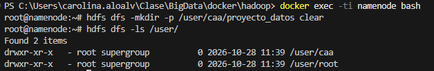

2. Carga de datasets
   
   - Descarga el dataset Automotive Price Prediction Dataset que puedes obtener desde Kaggle y que contiene un dataset sintético con información y precio de 1000000 de vehículos de segunda mano
  
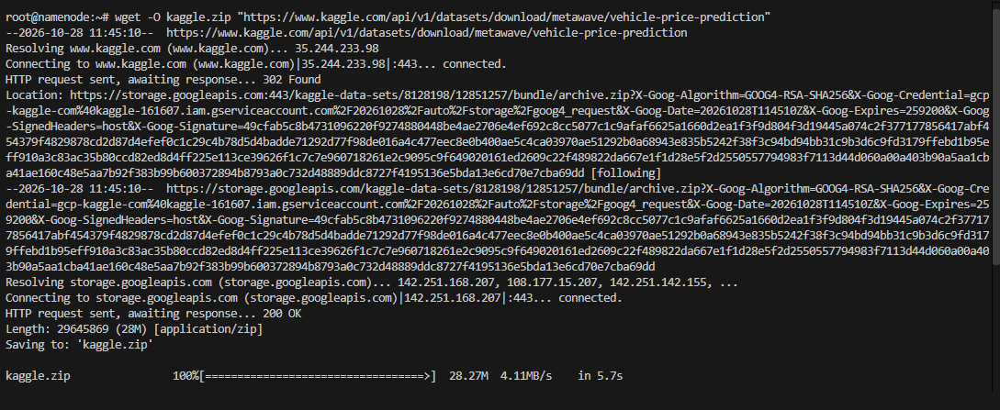

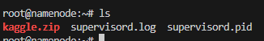

_Descargar unzip para poder abrir el archivo_

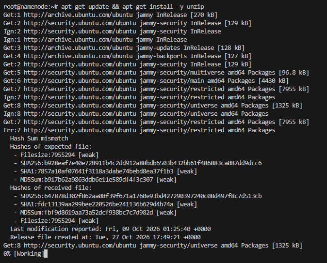

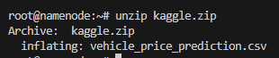

   - Desde tu sistema local, sube al directorio proyecto_datos el dataset que has descargado.

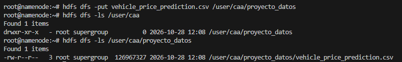

3. Exploración de datos
    - Visualiza el contenido del archivo directamente en HDFS.

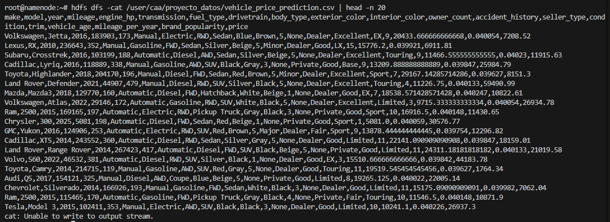

   - Obtén el número de líneas del dataset.

4. Organización del proyecto

    - Crea un subdirectorio procesados y otro backup dentro de tu carpeta de proyecto.

    - Copia el archivo original a backup.

    - Mueve el archivo original de proyecto_datos a procesados.

5. Colaboración en el equipo
    - Crea un directorio compartido bajo /compartido (si no existe) y copia allí tu dataset para que otros puedan acceder.

6. Recuperación de datos

    - Descarga a tu sistema local el archivo que está en el directorio procesados.

7. Control de accesos
    - Verifica los permisos de tus archivos.

    - Cambia los permisos de un archivo de backup para que solo tú tengas acceso de lectura y escritura.

8. Mantenimiento
    - Elimina un archivo temporal que hayas subido por error a tu espacio en HDFS.

# 3. Exploracion de datos
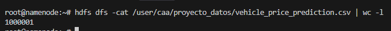
# 4. Organización de datos
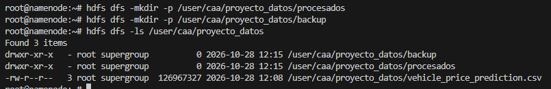
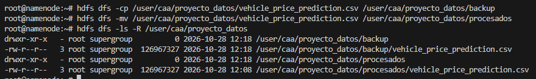
# 5. Colaboración en el equipo
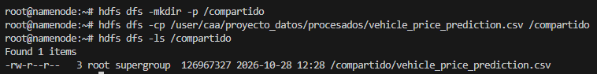
# 6. Recuperación de datos
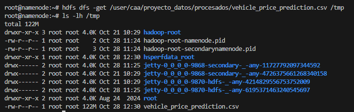
# 7. Control de accesos
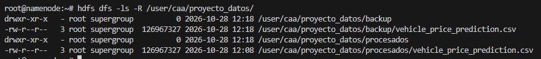
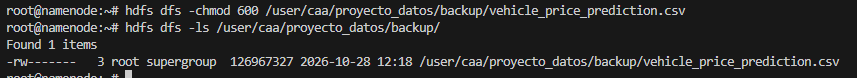
# 8. Mantenimiento
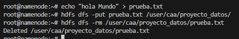